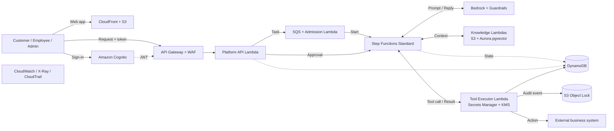

<div align="center" id="top">

# ☁️ VR Force

### Controlled, multi-tenant AI business automation on AWS

*A safe, auditable platform where many businesses run task-specific AI assistants without seeing each other's data, exceeding their budgets, or taking unapproved actions.*

**Beauty of Cloud 2.0 &nbsp;|&nbsp; Scenario 5 &nbsp;|&nbsp; University of Sri Jayewardenepura × IEEE Student Branch**

`AWS Serverless` &nbsp; `React 19 + TypeScript` &nbsp; `Python Lambda` &nbsp; `Cognito` &nbsp; `DynamoDB` &nbsp; `S3` &nbsp; `MVP Prototype`

<br>

<a href="#overview">Overview</a> &nbsp;•&nbsp;
<a href="#status">Status</a> &nbsp;•&nbsp;
<a href="#architecture">Architecture</a> &nbsp;•&nbsp;
<a href="#features">Features</a> &nbsp;•&nbsp;
<a href="#tech-stack">Tech Stack</a> &nbsp;•&nbsp;
<a href="#structure">Structure</a> &nbsp;•&nbsp;
<a href="#api">API</a> &nbsp;•&nbsp;
<a href="#data-model">Data Model</a>
<br>
<a href="#getting-started">Getting Started</a> &nbsp;•&nbsp;
<a href="#demo">Demo</a> &nbsp;•&nbsp;
<a href="#security">Security</a> &nbsp;•&nbsp;
<a href="#scale-and-cost">Scale &amp; Cost</a> &nbsp;•&nbsp;
<a href="#roadmap">Roadmap</a> &nbsp;•&nbsp;
<a href="#limitations">Limitations</a> &nbsp;•&nbsp;
<a href="#troubleshooting">Troubleshooting</a> &nbsp;•&nbsp;
<a href="#team">Team</a>

</div>

---

<a id="overview"></a>
## 📌 Overview

Connecting a chatbot straight to an LLM API gives a business no isolation, no approval flow and no cost control. **VR Force treats AI assistants as a governed platform instead.**

| | Risk | How VR Force addresses it |
|:-:|---|---|
| 🔓 | **Data exposure** | Every request is scoped to a tenant; data is partitioned per business |
| ⚠️ | **Unintended actions** | Sensitive actions pause for administrator approval; a tool executor validates every action |
| 📈 | **Uneven demand** | Queued admission with per-tenant concurrency and budget limits |
| 🔍 | **Unclear outcomes** | Task history, action records and tamper-resistant audit evidence |

> [!TIP]
> **Example:** a customer writes *"Please cancel my order."* One assistant handles the task end to end, using only that business's documents and permitted tools. An administrator approves the cancellation, and the evidence is recorded.

### Who it serves

| 👤 Customers & employees | 🏢 Business administrators | 🛠️ Platform operators |
|---|---|---|
| Get accurate results in everyday language | Control permissions, approvals and which company data is used | Keep the service reliable, safe and fair across tenants |

---

<a id="status"></a>
## 🧭 Project Status

This project has two parts: a **working MVP** and a **target architecture** documented in our proposal report. They are kept clearly separate.

| Capability | Status |
|---|:-:|
| React dashboard with Cognito sign-in | ✅ Built |
| Tenant resolution from Cognito groups (`shop-a`, `shop-b`) | ✅ Built |
| Order lookup and policy retrieval (DynamoDB + S3) | ✅ Built |
| Conversations, feedback and analytics endpoints | ✅ Built |
| Admin-only knowledge document upload (tenant-scoped S3 prefix) | ✅ Built |
| Rule-based assistant (`lambda_function_before_bedrock.py`) | ✅ Built, no LLM |
| Bedrock-powered assistant + Guardrails | 🟡 Partial: demo uses prompting; Bedrock Lambda is not in this repo |
| Frontend assistant chat page | 🟡 Partial: placeholder UI |
| SQS admission, Step Functions approvals, Tool Executor | 📐 Designed, not yet built |
| Aurora pgvector RAG, S3 Object Lock audit, multi-AZ recovery | 📐 Designed, not yet built |

---

<a id="architecture"></a>
## 🏗️ Target Architecture



**Request flow:** sign in → API Gateway and WAF → tenant and permission checks → queued admission (budget and concurrency) → Step Functions workflow. The workflow retrieves authorized context, calls the model, and passes any proposed action to the tool executor, which validates it. Sensitive actions wait for approval. The action runs and an audit record is written.

<details>
<summary><b>Key design choices</b> (click to expand)</summary>

<br>

| Layer | Choice | Why |
|---|---|---|
| Frontend | S3 + CloudFront | Static React app, no web server to maintain |
| Auth | Cognito | Managed login and tokens; backend still enforces tenant permissions |
| API | API Gateway REST + WAF | Native WAF and request validation |
| Compute | Lambda (Python) | Managed scaling for short operations |
| Fairness | SQS + Admission Lambda | One tenant's batch cannot starve others |
| Orchestration | Step Functions Standard | Durable progress and long human-approval waits |
| Model | Bedrock + native Guardrails | No GPU or model hosting to run |
| Knowledge | Aurora PostgreSQL + pgvector | Permissions, memory and vector search in one store |
| State | DynamoDB | Task status, approvals, usage and action records |
| Audit | S3 Object Lock | Evidence that cannot be silently rewritten |
| Network | VPC, endpoints, NAT | Private database access; outbound calls to business APIs |
| Observability | CloudWatch, X-Ray, CloudTrail | Failures, tenant workloads, traces and API activity |

</details>

---

<a id="features"></a>
## ✨ MVP Features

| 🔐 **Cognito sign-in** | 🏪 **Multi-tenant by design** | 📦 **Orders** |
|---|---|---|
| OIDC (`oidc-client-ts`) with protected routes | Each user must belong to exactly one shop group, or the request is rejected with `403` | Per tenant, keyed by `tenantId` and `orderId` |

| 📚 **Knowledge base** | 💬 **Conversations** | 📊 **Dashboard & analytics** |
|---|---|---|
| Tenant-specific policy documents in S3, admin-only uploads | Owner-only access, message limits, conditional writes | Order metrics by status |

| ⭐ **Feedback** | 🛡️ **Input validation** | 🏷️ **Demo tenants** |
|---|---|---|
| 1 to 5 rating plus comment | Message length, JSON shape, ID format and body-encoding checks | **Lotus Books** (`shop-a`) and **Ceylon Gadgets** (`shop-b`) |

---

<a id="tech-stack"></a>
## 🧰 Tech Stack

| Area | Technologies |
|---|---|
| **Frontend** | React 19, TypeScript, Vite, React Router 7, TanStack Query, Tailwind CSS, Recharts, Lucide icons |
| **Auth** | Amazon Cognito, `oidc-client-ts` |
| **Backend** | Python on AWS Lambda, `boto3` |
| **Data** | Amazon DynamoDB, Amazon S3 |
| **Planned** | Bedrock, Step Functions, SQS, Aurora pgvector, KMS, Secrets Manager, S3 Object Lock |

---

<a id="structure"></a>
## 🗂️ Repository Structure

```
.
├── lambda_function_before_bedrock.py   # Backend Lambda (rule-based, no LLM)
├── text doc/
│   ├── return-policy.txt               # Lotus Books policy (shop-a)
│   └── warranty-policy.txt             # Ceylon Gadgets policy (shop-b)
└── vr-force-prototype/                 # React + TypeScript frontend (Vite)
    └── src/
        ├── app/                        # Router
        ├── auth/                       # Cognito / OIDC
        ├── components/                 # Layout, auth, UI, feedback
        ├── config/                     # Environment config
        ├── features/                   # dashboard, orders, knowledge,
        │                               # assistant, conversations,
        │                               # analytics, security, settings
        ├── hooks/ services/ types/     # API client and data hooks
        └── utils/
```

---

<a id="api"></a>
## 🔌 API Reference

All routes require a valid Cognito JWT. The tenant is derived from the token's `cognito:groups` claim, **never from client input**.

| Method | Route | Description | Admin only |
|---|---|---|:-:|
| `GET` | `/me` | Current user, tenant and groups | |
| `GET` | `/orders` | List tenant orders (max 500) | |
| `GET` | `/orders/{orderId}` | Get one order | |
| `GET` | `/policy` | Tenant policy document | |
| `POST` | `/chat` | Assistant reply with sources | |
| `GET` `POST` | `/conversations` | List or create conversations | |
| `GET` `DELETE` | `/conversations/{conversationId}` | Read or delete (owner only) | |
| `POST` | `/feedback` | Submit rating and comment | |
| `GET` | `/dashboard`, `/analytics` | Order metrics | |
| `GET` | `/knowledge` | List tenant documents | |
| `POST` | `/knowledge` | Upload a text document | ✅ |

<details>
<summary><b>Example: chat request and response</b></summary>

<br>

```http
POST /chat
Authorization: Bearer <id_token>
Content-Type: application/json

{ "message": "What is the status of ORD-1001?", "conversationId": "<optional-uuid>" }
```

```json
{
  "message": "Chat response generated",
  "tenantId": "shop-a",
  "mode": "rule-based",
  "reply": "Order ORD-1001 from Lotus Books contains ... Its status is ...",
  "sources": [{ "type": "dynamodb", "reference": "ORD-1001" }],
  "tool": "order_lookup",
  "conversationId": null
}
```

**Current assistant behavior (rule-based):** an order ID such as `ORD-1234` triggers an order lookup. Words like *policy, return, refund, warranty, replacement* return the tenant's policy document. Anything else returns a welcome message.

</details>

<details>
<summary><b>Validation limits</b></summary>

<br>

| Field | Limit |
|---|---|
| Chat message | 1 to 2000 characters |
| Conversation | 40 messages |
| Conversation title / knowledge title | 100 characters |
| Knowledge document | 20,000 characters |
| Feedback comment | 1000 characters |
| Orders returned | 500 |
| Conversations listed | 50 |

</details>

---

<a id="data-model"></a>
## 🗄️ Data Model

| Store | Key | Main fields |
|---|---|---|
| DynamoDB `vrforce-orders` | `tenantId` (PK), `orderId` (SK) | `productName`, `status`, `amount`, `currency` |
| DynamoDB `vrforce-conversations` | `tenantId` (PK), `conversationId` (SK) | `ownerSub`, `title`, `messages[]`, `createdAt`, `updatedAt` |
| DynamoDB `vrforce-feedback` | `tenantId` (PK), `feedbackId` (SK) | `ownerSub`, `rating`, `comment`, `conversationId` (optional) |
| S3 bucket | `shop-a/return-policy.txt`, `shop-b/warranty-policy.txt` | Tenant policy documents |
| S3 bucket | `<tenantId>/knowledge/<uuid>-<title>.txt` | Admin-uploaded knowledge documents |

---

<a id="getting-started"></a>
## 🚀 Getting Started

> [!NOTE]
> **Prerequisites:** Node.js 18+ and npm, plus an AWS account with a Cognito user pool, an HTTP API in API Gateway, S3 and DynamoDB.

### Step 1: Backend (AWS)

Create the resources below, then deploy `lambda_function_before_bedrock.py` as a Python Lambda behind an API Gateway **HTTP API** with a JWT authorizer.

| Resource | Details |
|---|---|
| DynamoDB `vrforce-orders` | Partition key `tenantId`, sort key `orderId` |
| DynamoDB `vrforce-conversations` | Partition key `tenantId`, sort key `conversationId` |
| DynamoDB `vrforce-feedback` | Partition key `tenantId`, sort key `feedbackId` |
| S3 bucket | Upload `text doc/return-policy.txt` to `shop-a/return-policy.txt` and `text doc/warranty-policy.txt` to `shop-b/warranty-policy.txt` |
| Cognito groups | `shop-a`, `shop-b`, and `vrforce-admin` |
| Lambda env var | `POLICY_BUCKET=<your-bucket-name>` |
| Lambda IAM role | Read/write on the three tables and the bucket |
| API routes | One route per entry in the [API Reference](#api), all attached to the Lambda |

Assign each user to **exactly one** shop group. Add `vrforce-admin` for administrators. The default region in code is `ap-southeast-2`.

### Step 2: Frontend

```bash
cd vr-force-prototype
npm install
```

Create `.env.local`:

```env
VITE_AWS_REGION=ap-southeast-2
VITE_COGNITO_USER_POOL_ID=<user-pool-id>
VITE_COGNITO_CLIENT_ID=<app-client-id>
VITE_COGNITO_DOMAIN=<your-domain>.auth.<region>.amazoncognito.com
VITE_COGNITO_REDIRECT_URI=http://localhost:5173/
VITE_COGNITO_LOGOUT_URI=http://localhost:5173/
VITE_API_BASE_URL=https://<api-id>.execute-api.<region>.amazonaws.com
```

| Variable | Required | Purpose |
|---|:-:|---|
| `VITE_AWS_REGION` | Yes | AWS region |
| `VITE_COGNITO_USER_POOL_ID` | Yes | Cognito user pool |
| `VITE_COGNITO_CLIENT_ID` | Yes | Cognito app client |
| `VITE_COGNITO_DOMAIN` | Yes | Hosted UI domain |
| `VITE_COGNITO_REDIRECT_URI` | No | Defaults to `http://localhost:5173/` |
| `VITE_COGNITO_LOGOUT_URI` | No | Defaults to `http://localhost:5173/` |
| `VITE_API_BASE_URL` | Yes | API Gateway base URL |
| `VITE_CHAT_ENDPOINT` | No | Optional chat endpoint override |

Add your redirect and logout URLs to the Cognito app client's allowed callback and sign-out URLs.

```bash
npm run dev       # http://localhost:5173
npm run build     # production build
npm run preview   # preview the build
```

---

<a id="demo"></a>
## 🎬 Demo Walkthrough

1. Sign in as a **Lotus Books** user (`shop-a`) through Cognito.
2. Open **Orders** and see only Lotus Books orders.
3. Open **Knowledge** and view the return policy for that shop.
4. Ask the assistant about an order ID, or about returns and refunds, and note the cited source.
5. Sign in as a **Ceylon Gadgets** user (`shop-b`) and confirm the data, policy and answers are different.
6. Sign in as an admin and upload a knowledge document.

The deck separates what is working, partial and mocked in each step.

---

<a id="security"></a>
## 🔒 Security Model

| Control | How it works |
|---|---|
| **Identity** | Cognito verifies users; the backend resolves tenant membership on every request |
| **Isolation** | All data access is keyed by tenant (DynamoDB partition key, S3 prefix per tenant) |
| **Ownership** | Conversations are readable and deletable only by their owner, enforced with conditional writes |
| **Least privilege** | Knowledge uploads require the `vrforce-admin` group |
| **Planned** | PostgreSQL row-level security, KMS-backed encryption, Secrets Manager, S3 Object Lock audit, Bedrock Guardrails |
| **Privacy** | Minimal stored personal data, consent for optional long-term memory, tenant-defined retention rules |

> [!WARNING]
> Guardrails filter content but do not validate tool arguments. Tool arguments and business permissions are checked in backend code.

---

<a id="scale-and-cost"></a>
## 📈 Scale, Reliability and Cost

### Pilot targets *(require load and recovery testing)*

| ⚡ Task acceptance | ⏱️ Simple task completion | 🔁 Regional recovery | 💾 Data loss window |
|:-:|:-:|:-:|:-:|
| **under 1 second** | **under 30 seconds** | **8 hours** | **up to 1 day** |

### Estimated monthly cost: **about $1,040**

| Component | Cost |
|---|---:|
| LLM inference and embeddings | $326 |
| Native Bedrock Guardrails | $300 |
| Databases | $208 |
| Networking | $60 |
| Compute | $58 |
| Authentication and secrets | $30 |
| Storage, delivery and backups | $20 |
| Monitoring | $20 |
| API Gateway and WAF | $16 |
| Messaging | $2 |

These are proposal estimates. MVP spending is separate. Known scaling limits are Bedrock quotas and shared database capacity.

---

<a id="roadmap"></a>
## 🗺️ Roadmap

| Phase | Scope | Evidence before expansion |
|---|---|---|
| **1. MVP** *(current)* | React dashboard, Cognito auth, tenant-scoped orders and policies, conversations | Working walkthrough, explicit integration boundaries |
| **2. Business pilot** | RAG with document permissions, approved tools and action checks | Tenant isolation, approval and failure-path tests |
| **3. Scale validation** | Queued admission and budgets, monitoring, recovery | Load and quota testing, measured cost and restore results |
| **4. Later releases** | More connectors, specialized agents collaborating under a coordinator | Proven demand, controlled task and action ownership |

---

<a id="limitations"></a>
## ⚠️ Known Limitations

- Frontend runs locally; production hosting is not deployed
- The assistant chat page in the UI is a placeholder
- The backend in this repo is rule-based (no model calls)
- Model errors, shared database capacity, external API dependence and the regional recovery window remain open risks
- Performance, recovery and cost figures are unvalidated targets

---

<a id="troubleshooting"></a>
## 🩺 Troubleshooting

<details>
<summary><b>Common errors and fixes</b> (click to expand)</summary>

<br>

| Symptom | Likely cause |
|---|---|
| `403 Access denied: invalid tenant membership` | The user belongs to no shop group, or to more than one. Assign exactly one of `shop-a` / `shop-b`. |
| `VITE_API_BASE_URL is missing from .env.local` | The `.env.local` file is missing, or the dev server was not restarted after editing it. |
| `Your session has expired` (401) | The ID token expired. Sign in again. |
| `Policy document not found` (404) | The policy file is not at `shop-a/return-policy.txt` or `shop-b/warranty-policy.txt` in the bucket. |
| `Admin membership required` (403) | Knowledge upload needs the `vrforce-admin` group. |
| `Conversation message limit reached` | A conversation holds up to 40 messages. Start a new one. |
| Sign-in redirect fails | The redirect URI is not listed in the Cognito app client's callback URLs. |

</details>

---

<a id="team"></a>
## 👥 Team VR Force

| Name | Role |
|---|---|
| **H. M. T. R. Herath** | Team Lead |
| **R. A. V. U. Rajapaksha** | Team Member |

Faculty of Engineering, University of Sri Jayewardenepura

---

<div align="center">

Built for **Beauty of Cloud 2.0** &nbsp;|&nbsp; IEEE Student Branch, University of Sri Jayewardenepura

<a href="#top">⬆ Back to top</a>

</div>
